# Verified execution evidence

Student: **Md. Faisal Tabrez, 23261A0535**  
Faculty: **K. Rajitha, Associate Professor**

All implementation results refer to revision
`5c4d3af21c37617d5e3643ba0185b0d466ad8d2b` on
`devops/h5x-lab-project`. The report/evidence commit adds documentation and
saved artifacts after that tested implementation revision.

## Introduction

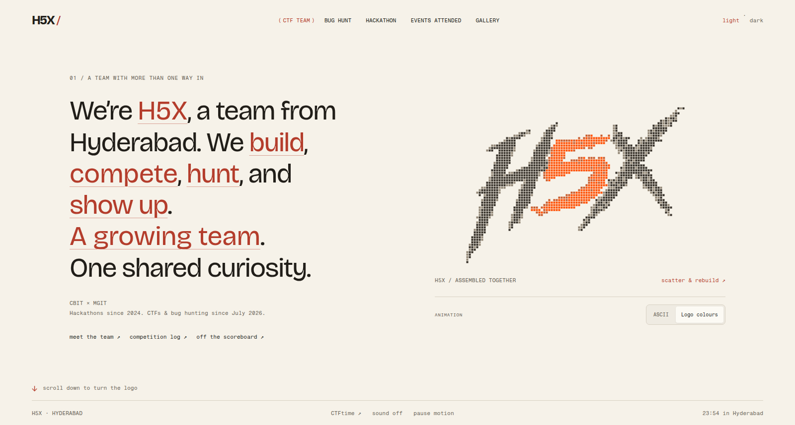

## Git and GitHub

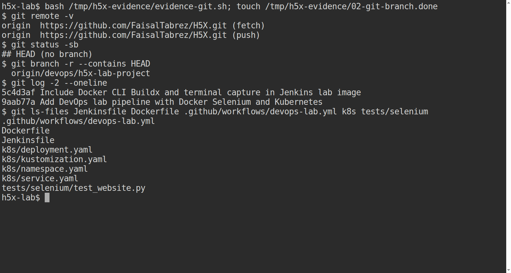

Jenkins uses a detached checkout of the exact revision. The remote branch
containing that revision is visible in the terminal output.

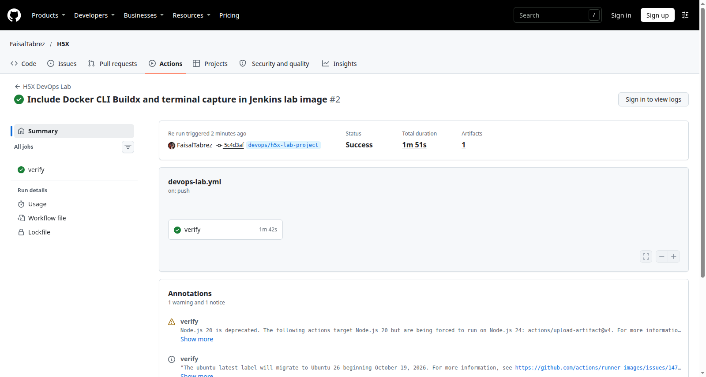

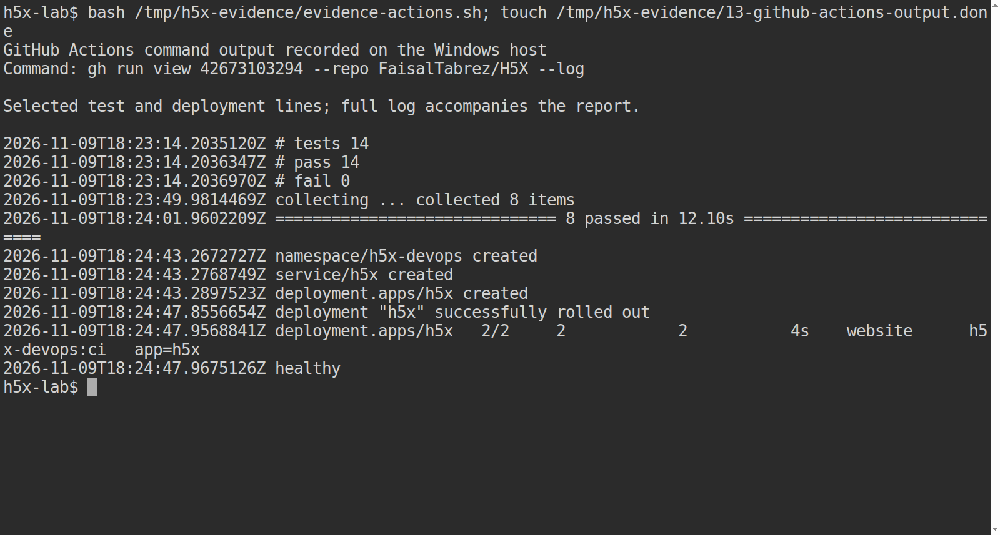

- [Successful run 42673103294 attempt 2](https://github.com/FaisalTabrez/H5X/actions/runs/42673103294)
- [Full command log](logs/github-actions.log)
- [Run and step metadata](logs/github-actions.json)
- [GitHub CLI run summary](logs/github-actions-summary.txt)
- [Downloaded JUnit, images and Kubernetes manifests](github-actions-run-42673103294/)

Attempt 1 stopped with a GitHub internal server error before a job was created.
Attempt 2 retried the same revision and passed. The original baseline run
42672579267 also passed; the report uses the later tested revision above.
The UI and complete CLI log retain the hosted runner's non-failing notices.

## Jenkins

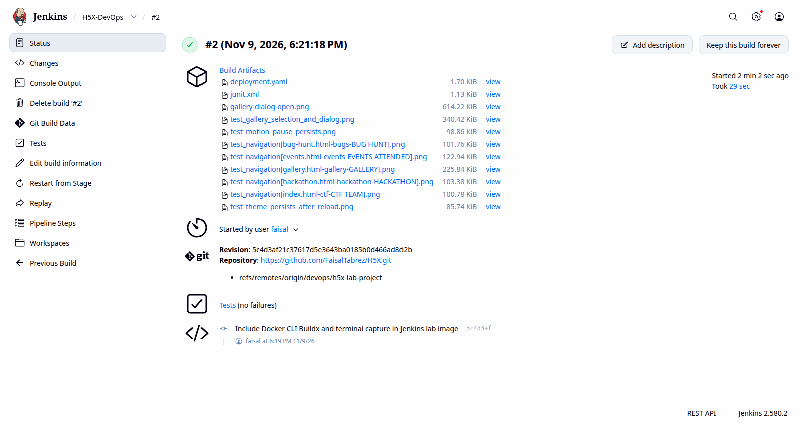

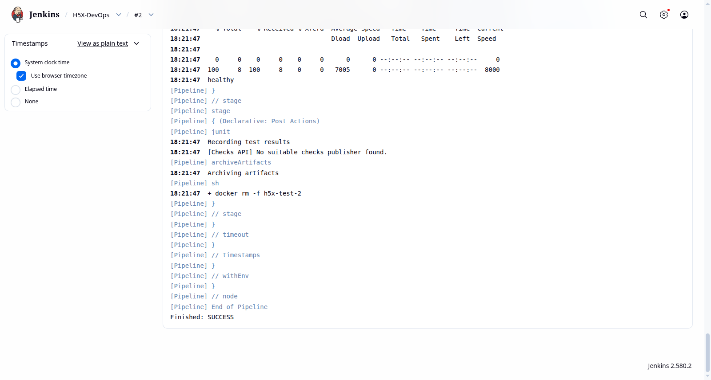

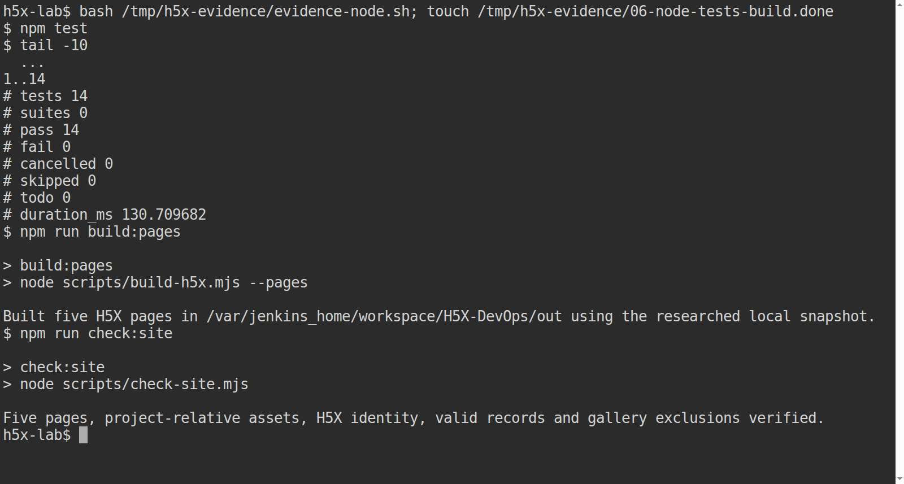

- [Jenkins build 2 console](logs/jenkins-build-2.log)
- [Jenkins build metadata](logs/jenkins-build-2.json)
- [Archived Jenkins artifacts](jenkins-build-2/)
- [Complete Node test output](logs/unit-tests.log)
- [Website build and validation](logs/website-build.log)

Build 1 found that Debian's docker.io package did not provide the Docker CLI.
The controller Dockerfile was corrected to copy Docker CLI and Buildx from the
official CLI image. Build 2 then passed all five stages. Passwords and
kubeconfigs are deliberately not included in this evidence folder.

## Docker

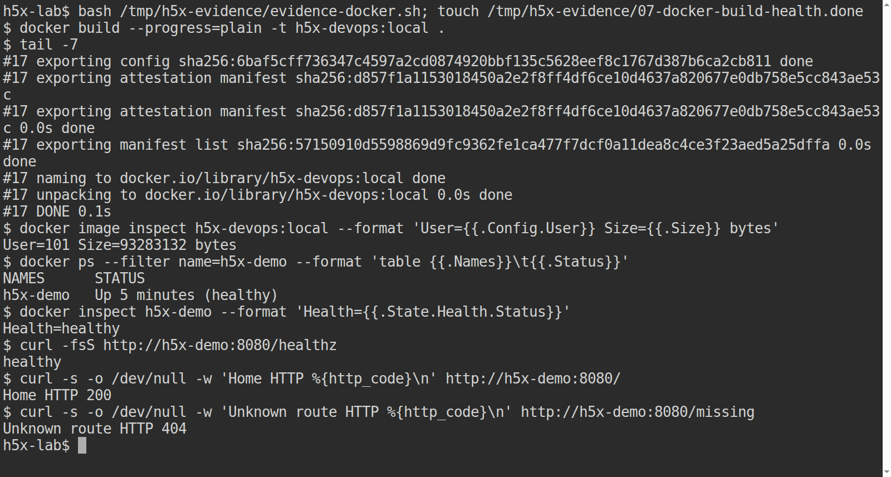

- [Website image build output](logs/docker-build.log)
- [Controller image build output](logs/jenkins-image-build.log)
- [Runtime health and HTTP checks](logs/evidence-docker.log)
- [Base-image digests recorded during execution](logs/base-image-digests.txt)

Observed runtime user: `101`. Observed local website image size: `93,283,132`
bytes. Container health was `healthy`; home and unknown routes returned
HTTP `200` and `404`, respectively.

## Selenium

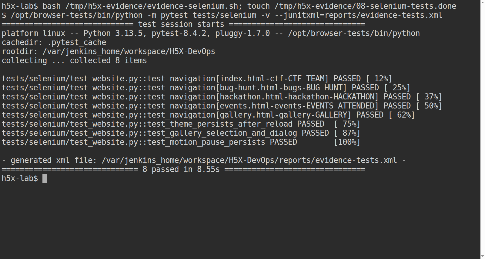

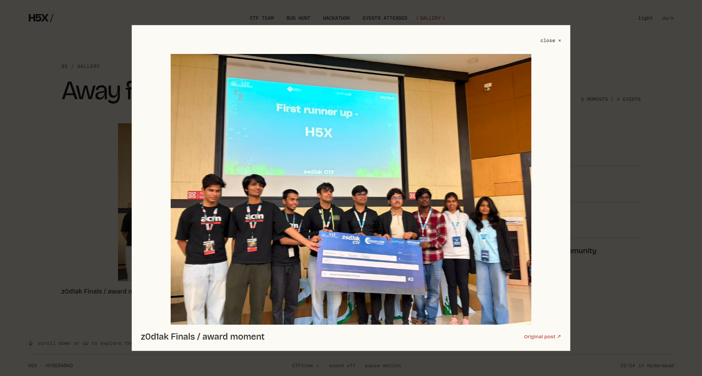

- [Captured browser test command output](logs/evidence-selenium.log)
- [Windows-host browser test run](logs/selenium-local.log)
- [Hosted runner JUnit](github-actions-run-42673103294/selenium/junit.xml)
- [Jenkins JUnit](jenkins-build-2/selenium/junit.xml)

There are five navigation cases and three interaction cases. All eight passed
locally, in Jenkins and in the hosted workflow. Test times describe individual
runs, not performance benchmarks.

## Kubernetes

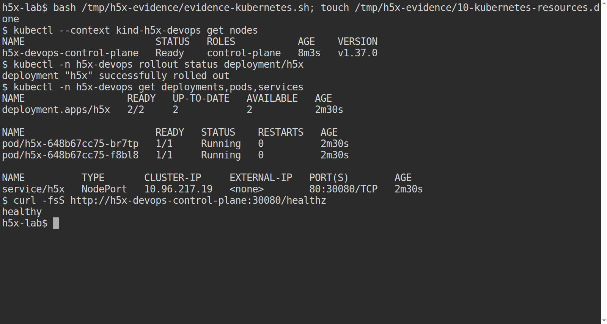

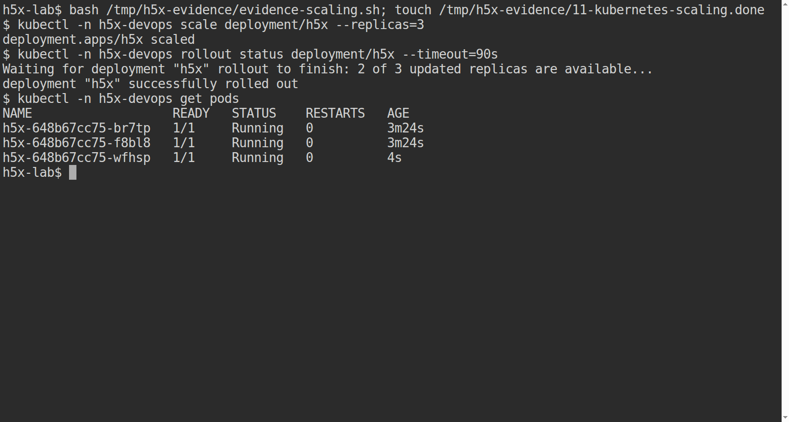

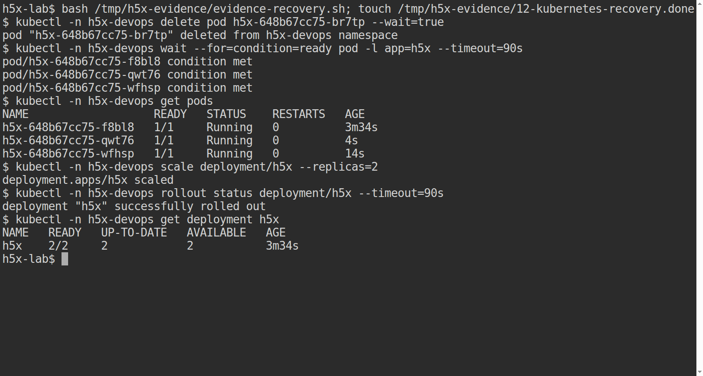

- [Cluster creation](logs/kind-create.log)
- [Deployment resources and health](logs/evidence-kubernetes.log)
- [Scaling](logs/evidence-scaling.log)
- [Pod replacement and restored replica count](logs/evidence-recovery.log)

The deleted pod ended in `br7tp`; the replacement ended in `qwt76`. The final
Deployment showed `2/2` ready. The cluster was real and local, with one node.
No autoscaling or production availability claim is made.

## How screenshots were captured

The terminal images are genuine browser-terminal screenshots from ttyd in the
local Jenkins container. Commands ran in that terminal and their output was
also saved using tee. The GitHub CLI ran on the Windows host; its saved output
was displayed in the terminal, explicitly labelled as recorded output. The
Actions screenshot selects actual test/deployment output lines for readability;
the complete downloaded log is also included.

Jenkins, GitHub and website images were captured from their actual browser
pages using Selenium. No terminal result, success indicator or browser content
was invented. Jenkins and Actions timestamps use UTC, while the website clock
displays Hyderabad time. `SHA256SUMS.txt` records the saved evidence hashes.
